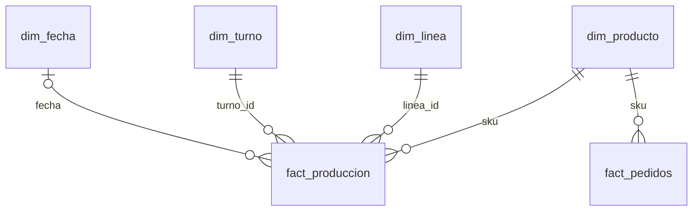

# Power BI: los dos dashboards

Los `.pbix` no se ven en GitHub ni se abren en macOS. Lo que sigue se extrajo de los
archivos con código: la definición del reporte (JSON dentro del `.pbix`) y el modelo
(consultas de Power Query, tablas y columnas, leídos con `pbixray`).

| Archivo | Datos | Página |
|---|---|---|
| [`Metalurgica Andina Calidad y Paros v1.pbix`](../entregables/powerbi/Metalurgica%20Andina%20Calidad%20y%20Paros%20v1.pbix) | Tres meses (consolidado) | 1 página, 1280 × 720 |
| [`Cruz_Demian_PQ_Produccion.pbix`](../entregables/powerbi/Cruz_Demian_PQ_Produccion.pbix) | Marzo, limpiado dentro de Power Query | 1 página, 1920 × 1080 |

> `TODO(demian)`: exportar desde Power BI Desktop (Archivo → Exportar → PDF) y guardar una
> captura de cada página en `docs/img/powerbi_calidad_paros.png` y
> `docs/img/powerbi_pq_marzo.png`. Sin eso un reclutador no puede ver los dashboards.

## 1. Calidad y Paros de Producción (tres meses)

**Pregunta de negocio:** ¿dónde se concentran los defectos y el tiempo de paro: en qué
línea, turno, categoría y producto?


| Visual | Campos | Qué responde |
|---|---|---|
| Tarjeta "Corridas" | Recuento de `ID_Registro` | Cuántas corridas hay en la selección |
| Tarjeta "Unidades Producidas" | Suma de `Cantidad_Producida` | Volumen |
| Tarjeta "Unidades Defectuosas" | Suma de `Unidades_Defectuosas` | Defectos en unidades |
| Tarjeta "Paro (min)" | Suma de `Tiempo_Paro_Min` | Tiempo perdido |
| Tarjeta "Costo (US $)" | Suma de `Costo_Total` | Costo de lo producido |
| Columnas agrupadas "Paro (min) por línea y turno" | `línea_Produccion`, `Turno`, suma de paro | Qué combinación línea-turno pierde más tiempo |
| Matriz "% Defectuoso promedio por corrida (línea x turno)" | Promedio de `% Defectuosos` | Qué combinación tiene peor calidad |
| Barras 100 % apiladas "Mezcla de nivel de calidad por categoría" | `Categoria`, `Calidad_3_Niveles`, recuento | Qué categoría tiene más corridas críticas |
| Barras "Top 5 SKU por unidades defectuosas" | `SKU`, suma de defectuosas, filtro Top N | Qué productos atacar primero |
| Segmentadores | `línea_Produccion`, `Turno`, `Categoria` | Filtran todo lo anterior |

**Modelo:** una sola tabla, `tbl_Prod` (15 columnas), cargada desde un Excel consolidado
en OneDrive. Además existe la tabla de fechas automática de Power BI
(`LocalDateTable`, generada por la opción "Fecha y hora automáticas").

**Power Query:** solo tipa las columnas; la limpieza ya venía hecha desde el Excel.
Código completo en [`power_query/calidad_paros_tbl_Prod.pq`](power_query/calidad_paros_tbl_Prod.pq).

**Cifras que deberían mostrar las tarjetas sin filtros**, según el consolidado del repo
(`TODO(demian)`: confirmar contra la captura):

| Tarjeta | Valor esperado |
|---|---|
| Corridas | 290 |
| Unidades Producidas | 73.148 |
| Unidades Defectuosas | 2.162 |
| Paro (min) | 3.790 |
| Costo (US $) | 366.882,29 |

Dos cosas por confirmar al abrir el archivo:

- El modelo guarda **285** valores distintos de `ID_Registro`, y el consolidado del repo
  tiene 290 corridas. La fuente del dashboard es otro archivo
  (`Metalurgica Andina 3 Meses Consolidado.xlsx`, tabla `tbl_Prod`), que no está en el repo.
  Si la tarjeta "Corridas" no dice 290, ese archivo no es igual al consolidado entregado.
- El consolidado mezcla `No Cumple` y `No cumple`. Si esa columna se usa en un filtro o
  leyenda, aparecerán como dos categorías.

## 2. Ejercicio de Power Query (marzo)

**Pregunta de negocio:** con los datos de marzo limpiados dentro de Power BI, ¿cuánto
costó producir, cuántas unidades salieron defectuosas y cómo se reparten por categoría,
línea y turno?


| Visual | Campos |
|---|---|
| Tarjeta | Suma de `Costo_Total_Producido` |
| Tarjeta | Suma de `Unidades_Defectuosas` |
| Matriz | `Linea_Produccion` × `Turno`, suma de `Cantidad_Producida` |
| Tabla | `Clasificación_Calidad`, recuento de `ID_Registro` |
| Columnas "Unidades defectuosas por categoría" | `Categoria`, suma de defectuosas |
| Segmentadores | `Categoria`, `Turno` |

**Este archivo es el que demuestra Power Query.** La consulta `Produccion_Limpia` parte de
la tabla sucia y hace toda la limpieza en 37 pasos; el código M completo está en
[`power_query/pq_marzo_Produccion_Limpia.pq`](power_query/pq_marzo_Produccion_Limpia.pq).

| Paso de Power Query | Función M | Equivalente en Python |
|---|---|---|
| Recortar y capitalizar línea, turno y SKU | `Text.Trim`, `Text.Proper`, `Table.ReplaceValue` | `normalize_linea_produccion`, `normalize_turno`, `normalize_sku` |
| Detectar el formato de fecha | `Table.AddColumn` con `Text.Contains` | `classify_date_format` |
| Resolver fechas con barras con el rango de meses válido; si no se puede, `null` y "REVISAR CON SUPERVISOR" | `#date`, `Date.FromText` con `Culture = "en-US"` | `parse_date(..., meses_validos)` |
| Quitar duplicados exactos | `Table.Distinct` | `deduplicate_exact` |
| Llenar turnos vacíos con la tabla `Correcciones_Turno` | `Table.NestedJoin` (izquierda) | `resolve_turnos` + `data/manual/turno_overrides.csv` |
| Cruzar con el catálogo | `Table.NestedJoin` + `Table.ExpandTableColumn` | `join_con_catalogo` |
| Costo total y % defectuosas | columnas calculadas | `compute_financials` |
| Clasificación y turno problemático | columnas condicionales | `classify` |

Los 5 paros vacíos se dejan en `null` a propósito; el comentario está en el propio código M:
`// 5 vacíos de Tiempo_Paro_Min se dejan en null; no hay confirmación de que sean 0`.

**Cifras esperadas sin filtros** según el pipeline de Python sobre marzo
(`TODO(demian)`: confirmar contra la captura): costo total producido USD 87.841,83 y
691 unidades defectuosas.

## 3. Producción, Calidad, Paros y costos (marzo, en construcción)

Dashboard de tres páginas que se está armando en la clase, sobre la misma consulta de
Power Query del ejercicio anterior. `TODO(demian)`: agregar el `.pbix` y sus capturas
cuando esté terminado.

| Página | Pregunta de negocio | Lo que debe poder leer el gerente |
|---|---|---|
| Producción | ¿Cuánto producimos, dónde y cuándo? | 22.934 unidades; la Línea 1 produce más (7.994); Tornillería es la categoría de mayor volumen (8.096) |
| Calidad | ¿Cumplimos la meta de 3 % de defectuosas? | 43 de 90 corridas son críticas; solo 2 turnos son problemáticos |
| Paros y costos | ¿Dónde perdemos tiempo y dónde se concentra el costo? | El turno de la tarde para menos (12,3 min por corrida frente a 15,3); el costo se concentra en Engranajes (USD 54.323 de 87.842) |

Cada página tiene 3 segmentadores, 3 tarjetas y 3 visuales; las páginas comparten
segmentadores sincronizados y un navegador.

**Ya está validado sin abrir Power BI.** La guía de la clase trae los valores que debe
mostrar cada tarjeta y cada visual. [`tests/test_guia_powerbi.py`](../tests/test_guia_powerbi.py)
comprueba que el pipeline de Python llega a los mismos números:

| Página | Qué se comprueba |
|---|---|
| Producción | Tarjetas (22.934, 691, 87,84 K), producción por línea y por categoría, 13 días con máximo y mínimo, y la interacción al filtrar Línea 1 |
| Calidad | Tarjetas (90, 691, 2), calidad por línea, top 5 de productos con más defectuosas y las 2 filas de turnos problemáticos |
| Paros y costos | Paro promedio 14,5 min y total 1.235, paro promedio por turno, matriz de costo categoría × línea y top 5 de productos por costo |

El paro promedio es 14,5 y no 13,7 porque los 5 paros vacíos no se cuentan como 0: es la
misma decisión en Power Query y en Python.

## Medidas DAX

**Ninguno de los dos archivos tiene medidas DAX.** Todos los visuales usan agregaciones
implícitas (suma, promedio, recuento) sobre columnas. Las únicas expresiones DAX del
modelo son las de la tabla de fechas automática (`YEAR([Date])`, `MONTH([Date])`, etc.).

Si quieres mostrar DAX en el portafolio, estas tres medidas serían las naturales para
este dashboard. Están propuestas, no extraídas: `TODO(demian)` crearlas en Power BI y
pegar aquí la versión final.

```dax
% Defectuoso Ponderado = DIVIDE ( SUM ( tbl_Prod[Unidades_Defectuosas] ), SUM ( tbl_Prod[Cantidad_Producida] ) )
Corridas Críticas = CALCULATE ( COUNTROWS ( tbl_Prod ), tbl_Prod[Calidad_3_Niveles] = "Crítico" )
% Corridas Críticas = DIVIDE ( [Corridas Críticas], COUNTROWS ( tbl_Prod ) )
```

La primera corrige una limitación real de la matriz actual: promedia el % de cada corrida
sin ponderar por volumen, así que una corrida de 100 unidades pesa igual que una de 400.

## Modelo de datos

Hoy cada dashboard usa una sola tabla plana:


El repo propone una alternativa: usar como fuente los CSV que genera
`python -m src.sql_load` en `data/processed/vistas/`, o las tablas del modelo estrella de
[`sql/schema.sql`](../sql/schema.sql). Así el dashboard consumiría datos ya limpios,
versionados y cubiertos por tests.



Todas las relaciones son de uno a varios. `fact_produccion.fecha` admite nulos: son las
3 corridas con fecha ambigua pendiente de supervisor.

## Antes de publicar

- Los dos `.pbix` guardan por dentro la URL de la cuenta de OneDrive de la universidad
  (incluye el usuario institucional). En estos documentos se reemplazó por `<OneDrive>`,
  pero sigue dentro de los archivos. Decide si eso te parece bien antes de subirlos.
