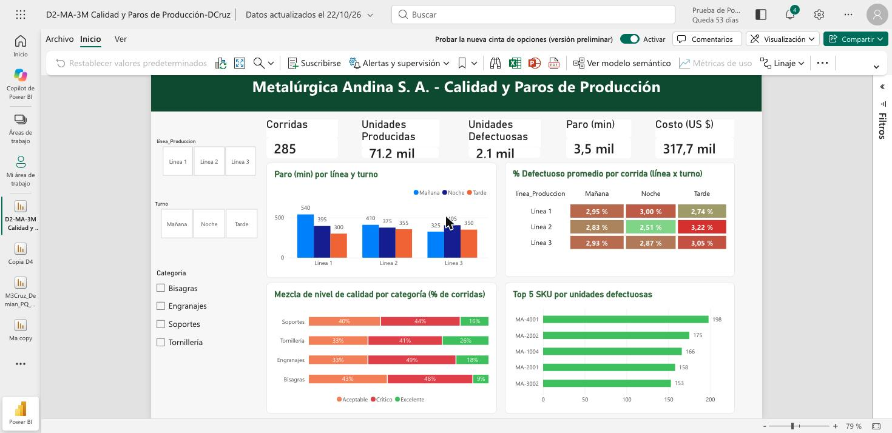
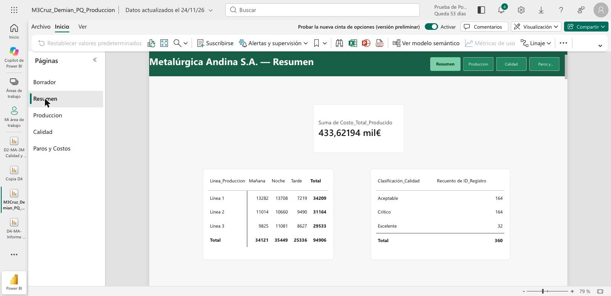
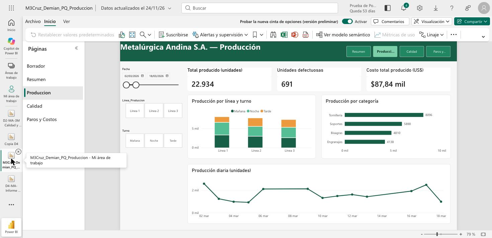
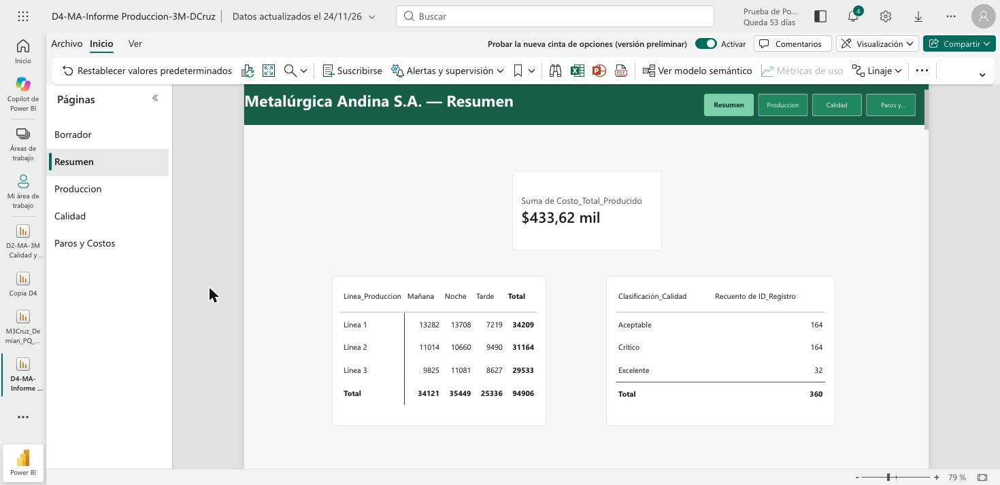
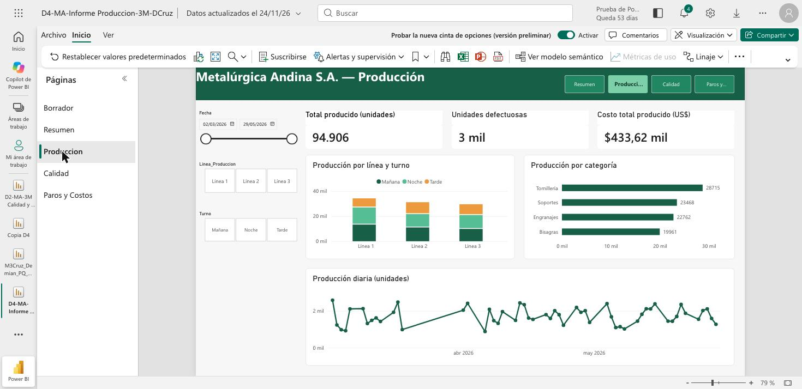
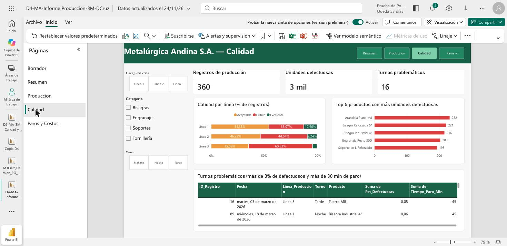
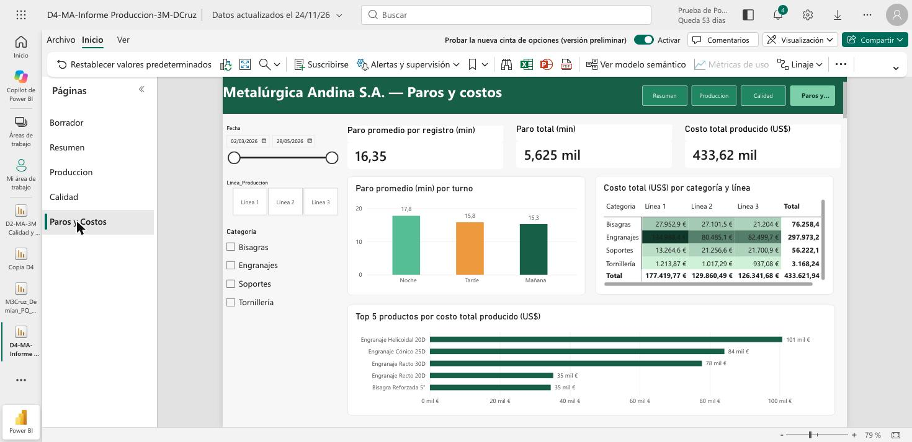
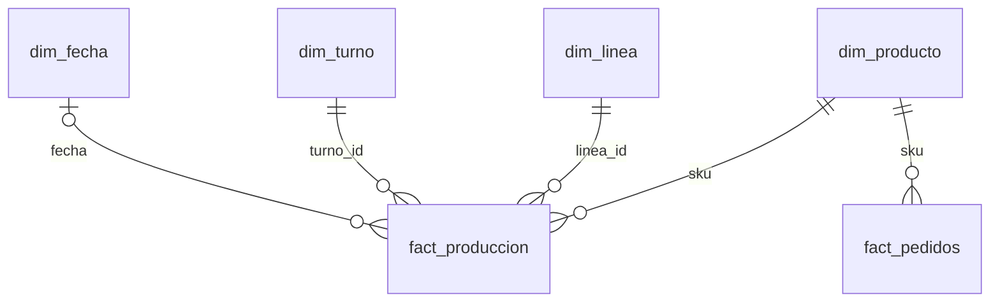

# Power BI: tres informes

Informes hechos para la clase de Power BI IIN2002 (USFQ). Las capturas son de Power BI
Service y están tal cual en [`img/`](img/). Los `.pbix` **no están en el repo**: guardan
por dentro la ruta de OneDrive institucional. `.gitignore` los excluye y
`tests/test_privacy.py` falla si alguno se versiona.

| Informe | Páginas con captura | Filtro de fechas visible |
|---|---|---|
| **D2** Calidad y Paros de Producción | 1 página | Ninguno |
| **D3** Informe de Producción (ejercicio de Power Query) | Resumen, Producción | Producción: 02/03/2026 a 18/03/2026. Resumen: ninguno |
| **D4** Informe de Producción | Resumen, Producción, Calidad, Paros y costos | 02/03/2026 a 29/05/2026 |

El periodo de cada informe se toma solo del filtro de fechas que se ve en la captura, no
del nombre del archivo. D1 (pedidos y entregas) queda fuera de este documento.

**De dónde sale cada cifra.**
- **Power BI:** las cifras se leyeron de las capturas, con el redondeo que muestra cada
  tarjeta (por ejemplo, "3 mil").
- **Pipeline:** la columna "Pipeline" sale de estos dos comandos:

```bash
python -m src.cli > /dev/null          # escribe data/processed/ y las vistas SQL
python3 scripts/cifras_powerbi.py      # agrega lo que muestran las tarjetas
```

## D2. Calidad y Paros de Producción

**Pregunta de negocio:** ¿dónde se concentran los defectos y el tiempo de paro: en qué
línea, turno, categoría y producto?



| Visual | Campos | Qué responde |
|---|---|---|
| Tarjetas | Recuento de `ID_Registro`; sumas de `Cantidad_Producida`, `Unidades_Defectuosas`, `Tiempo_Paro_Min` y `Costo_Total` | Volumen, defectos, paro y costo de la selección |
| Columnas agrupadas "Paro (min) por línea y turno" | `línea_Produccion`, `Turno` | Qué combinación línea-turno pierde más tiempo |
| Matriz "% Defectuoso promedio por corrida (línea x turno)" | Promedio de `% Defectuosos` | Qué combinación tiene peor calidad |
| Barras 100 % apiladas "Mezcla de nivel de calidad por categoría" | `Categoria`, `Calidad_3_Niveles` | Qué categoría tiene más corridas críticas |
| Barras "Top 5 SKU por unidades defectuosas" | `SKU`, filtro Top N | Qué productos atacar primero |
| Segmentadores | `línea_Produccion`, `Turno`, `Categoria` | Filtran todo lo anterior |

**Modelo:** una sola tabla, `tbl_Prod`, cargada con una consulta de Power Query de 6 líneas
desde un Excel en OneDrive que no está en el repo. La versión del repo, con la URL
reemplazada, está en [`power_query/calidad_paros_tbl_Prod.pq`](power_query/calidad_paros_tbl_Prod.pq).
Su texto no es idéntico al de D2 y no los comparé paso a paso.

| Tarjeta | Power BI | Pipeline, tres meses |
|---|---|---|
| Corridas | 285 | 290 |
| Unidades Producidas | 71,2 mil | 73.148 |
| Unidades Defectuosas | 2,1 mil | 2.162 |
| Paro (min) | 3,5 mil | 3.790 |
| Costo (US $) | 317,7 mil | 365.045,29 |

D2 no tiene filtro de fechas visible. Por eso lo comparo con los tres meses del pipeline,
y ninguna tarjeta coincide (ver [Diferencias](#diferencias)).

## D3. Informe de Producción (ejercicio de Power Query)

**Pregunta de negocio:** con los datos limpiados dentro de Power Query, ¿cuánto se produjo,
cuánto costó y cómo se reparte por línea, turno y categoría?

Páginas del informe: Resumen, Producción, Calidad, Paros y Costos, más una página Borrador.
Hay captura de las dos primeras.





**Modelo:** una sola tabla, `Produccion_Limpia`, armada en Power Query (48 líneas de M).
La limpieza se explica paso a paso en
[`power_query/pq_marzo_Produccion_Limpia.pq`](power_query/pq_marzo_Produccion_Limpia.pq).
Ese texto no es idéntico al de D3 y no los comparé paso a paso.

| Página | Tarjeta | Power BI | Pipeline | Coincide |
|---|---|---|---|---|
| Producción (02 a 18 mar) | Total producido (unidades) | 22.934 | 22.934 (marzo) | Sí |
| Producción (02 a 18 mar) | Unidades defectuosas | 691 | 691 (marzo) | Sí |
| Producción (02 a 18 mar) | Costo total producido (US$) | $87,84 mil | 87.841,83 (marzo) | Sí |
| Resumen (sin filtro) | Suma de Costo_Total_Producido | 433,62194 mil€ | 365.045,29 (tres meses) | No |

El pipeline de marzo va del 02/03/2026 al 18/03/2026, el mismo rango que el filtro de la
página Producción. [`tests/test_guia_powerbi.py`](../tests/test_guia_powerbi.py) ya
comprueba estas cifras de marzo contra la guía de la clase.

La página Resumen no tiene filtro de fechas visible. Muestra lo mismo que el Resumen de D4:
94.906 unidades en la matriz línea × turno y 360 registros (Aceptable 164, Crítico 164,
Excelente 32). Así, en D3 las páginas Resumen y Producción cubren periodos distintos.

## D4. Informe de Producción

**Pregunta de negocio:** las mismas tres preguntas del ejercicio de clase (producción,
calidad, paros y costos), con todos los meses disponibles.

> **OJO:** que D4 sea el informe "combinado" es una suposición. Se basa en su filtro de
> fechas (02/03/2026 a 29/05/2026), no en una confirmación.









Cada página tiene segmentadores (línea, turno o categoría, y fecha en Producción y Paros y
costos), tres tarjetas y un navegador entre páginas. **Modelo:** una sola tabla,
`Produccion_Limpia` (50 líneas de M).

| Página | Tarjeta | Power BI | Pipeline, tres meses |
|---|---|---|---|
| Resumen | Suma de Costo_Total_Producido | $433,62 mil | 365.045,29 |
| Producción | Total producido (unidades) | 94.906 | 73.148 |
| Producción | Unidades defectuosas | 3 mil | 2.162 |
| Producción | Costo total producido (US$) | $433,62 mil | 365.045,29 |
| Calidad | Registros de producción | 360 | 290 |
| Calidad | Unidades defectuosas | 3 mil | 2.162 |
| Calidad | Turnos problemáticos | 16 | 9 |
| Paros y costos | Paro promedio por registro (min) | 16,35 | 13,63 |
| Paros y costos | Paro total (min) | 5,625 mil | 3.790 |
| Paros y costos | Costo total producido (US$) | 433,62 mil | 365.045,29 |
| Resumen (tabla) | Aceptable / Crítico / Excelente | 164 / 164 / 32 | 112 / 135 / 43 |

El filtro de fechas de D4 tiene el mismo rango que el pipeline de tres meses (02/03/2026 a
29/05/2026), pero ninguna tarjeta coincide.

## Diferencias

No se ajustó ninguna cifra. Donde la causa dice "sin verificar", es porque no abrí la
fuente del `.pbix` para comprobarla.

| # | Qué difiere | Valores | Causa |
|---|---|---|---|
| 1 | D2 frente a D4 | 285 corridas y 71,2 mil u, frente a 360 registros y 94.906 u | Sin verificar. Cargan tablas distintas (`tbl_Prod` y `Produccion_Limpia`) desde fuentes en OneDrive que no están en el repo |
| 2 | D2 frente al pipeline | 285 frente a 290 corridas. Las otras 4 tarjetas también difieren (tabla de D2) | Sin verificar. D2 lee un Excel consolidado de OneDrive, no el dato crudo del repo |
| 3 | D4 frente al pipeline | 360 frente a 290 registros, 94.906 frente a 73.148 u y el resto de la tabla de D4 | Sin verificar. Dato: el pipeline parte de 305 filas crudas (95 + 210, salida de `python -m src.cli`). 360 es más que eso, así que la diferencia no se explica solo por los duplicados |
| 4 | D3 Resumen frente a D3 Producción | 433,62 mil frente a 87,84 mil de costo | La página Resumen no tiene filtro de fechas visible y suma lo mismo que D4. La página Producción está filtrada del 02 al 18 de marzo |
| 5 | Moneda | Los títulos dicen "US$". En D3 la tarjeta del Resumen muestra €. En D4 la matriz y el top 5 de Paros y costos muestran € | Formato de moneda distinto entre visuales del mismo campo. Sin verificar en el `.pbix` |
| 6 | Defectuosas en D4 | La tarjeta dice "3 mil"; el pipeline, 2.162, que redondearía a "2 mil" | Sin verificar. Va en la misma dirección que la diferencia 3 |

## Medidas DAX

**Sin medidas DAX propias; las 12 columnas calculadas son de la tabla de fechas automática.**
Vale para D2, D3 y D4. Todos los visuales usan agregaciones implícitas (suma, promedio,
recuento) sobre columnas. Las 12 columnas calculadas están en las tablas `LocalDateTable_…`
y `DateTableTemplate_…`, que Power BI crea con la opción "Fecha y hora automáticas"
(`YEAR([Date])`, `MONTH([Date])`, `FORMAT([Date], "MMMM")`, etc.).

Para comprobarlo, se corre en local sobre los `.pbix`, que no están en el repo. `pbixray`
no es dependencia del proyecto: se instala en un entorno aparte.

```bash
python3 -m venv /tmp/pbix && /tmp/pbix/bin/pip install pbixray
/tmp/pbix/bin/python -c '
import sys; from pathlib import Path; from pbixray import PBIXRay
for p in sorted(Path(sys.argv[1]).glob("D[234]-*.pbix")):
    m = PBIXRay(str(p)); c = m.dax_columns
    print(p.name[:2], "medidas:", len(m.dax_measures), "columnas calculadas:", len(c),
          "tablas:", sorted({t.split("_")[0] for t in c["TableName"]}))
' "<carpeta con los .pbix>"
```

Salida: `medidas: 0 columnas calculadas: 12 tablas: ['DateTableTemplate', 'LocalDateTable']`
para cada informe.

Si se quiere mostrar DAX, estas serían las medidas naturales. Están propuestas, no
extraídas:

```dax
% Defectuoso Ponderado = DIVIDE ( SUM ( tbl_Prod[Unidades_Defectuosas] ), SUM ( tbl_Prod[Cantidad_Producida] ) )
Corridas Críticas = CALCULATE ( COUNTROWS ( tbl_Prod ), tbl_Prod[Calidad_3_Niveles] = "Crítico" )
% Corridas Críticas = DIVIDE ( [Corridas Críticas], COUNTROWS ( tbl_Prod ) )
```

La primera corrige una limitación de la matriz de D2: promedia el % de cada corrida sin
ponderar por volumen, así que una corrida de 100 unidades pesa igual que una de 400.

## Modelo de datos

Hoy cada informe usa una sola tabla plana:


El repo propone una alternativa: usar como fuente los CSV que genera
`python -m src.sql_load` en `data/processed/vistas/`, o las tablas del modelo estrella de
[`sql/schema.sql`](../sql/schema.sql). Así el dashboard consumiría datos ya limpios,
versionados y cubiertos por tests, y las diferencias 1 a 3 desaparecerían por
construcción.



Todas las relaciones son de uno a varios. `fact_produccion.fecha` admite nulos: son las
3 corridas con fecha ambigua pendiente de supervisor.

## Privacidad

- Los `.pbix` se quedan fuera del repo. Para mostrarlos se usan capturas de Power BI
  Service, que no llevan la ruta de OneDrive.
- Antes de copiarlas se revisó que no muestren correos, rutas ni nombres ajenos.
  [`tests/test_docs_powerbi.py`](../tests/test_docs_powerbi.py) falla si una imagen o un PDF
  versionado declara en sus metadatos un autor o un "modificado por" distinto de Demian.
- En el código de Power Query de [`power_query/`](power_query/) la URL se reemplazó por
  `<OneDrive>`.
